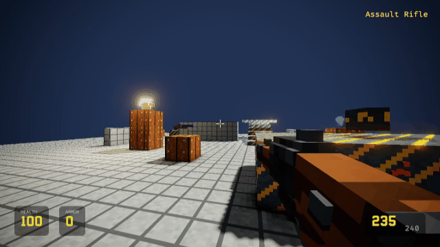
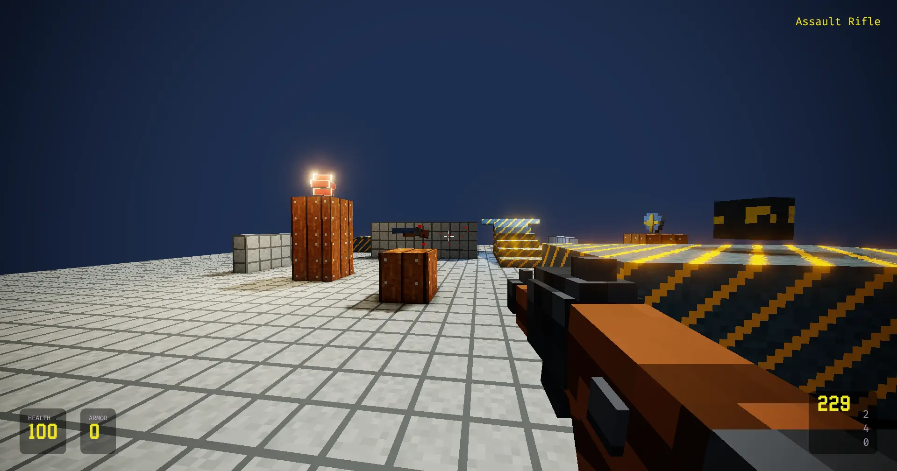
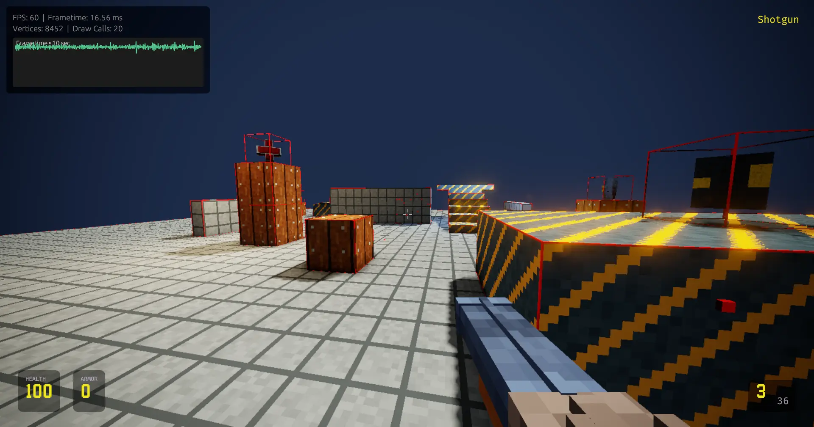

<p align="center">
  
</p>

<h1 align="center">VIBE GAME KIT</h1>

<p align="center">
  <strong>A little FPS world. A lot of room to experiment.</strong><br>
  A configurable, blocky FPS sandbox and rendering playground built with Rust, wgpu, and egui.
</p>

<p align="center">
  <a href="README.md">English</a> &nbsp;·&nbsp; <a href="README.ru.md">Русский</a>
</p>

<p align="center">
  
  
  
</p>

<br>

<p align="center">
  
</p>

## The short version

Vibe Game Kit is a native first-person playground for building and tuning a small game world. Walk a concrete test range, pick up weapons, tune the rendering pipeline, and edit the world in plain text files. The project keeps the pieces visible: maps, models, materials, gameplay settings, and graphics options are all yours to change.

| **Play** | **Build** | **Tune** |
|:--|:--|:--|
| Smooth movement, jumping, pickups, weapon switching, firing, and recoil | `.map` levels, OBJ props, Minecraft-style JSON models, tiny PPM textures | Deferred lighting, shadows, SSAO, bloom, eye adaptation, and render scale |

## See it in motion

<p align="center">
  
</p>

<p align="center">
  
</p>

<p align="center">
  
</p>

The optional debug view overlays collision bounds and a live frame-time graph—handy while iterating on a level.

## Get started

You’ll need a working [Rust toolchain](https://www.rust-lang.org/tools/install) and a graphics adapter supported by wgpu. From the project root, run:

```sh
cargo run --release
```

The default launch loads `game.toml` and the map configured in `settings.toml` (`assets/map/map1.map`). To load another game or map:

```sh
cargo run --release -- --game games/blue/game.toml --map maps/night-yard.map
```

`--game` can also be written as the first positional argument; `--map` overrides the map path for this launch. On Windows, the application icon is embedded in the executable during the build.

## Controls

| Input | Action |
|:--|:--|
| Click the window | Capture the mouse; move the mouse to look |
| `W` `A` `S` `D` | Move |
| `Shift` | Sprint; FOV widens smoothly |
| `Space` | Jump; hold to auto-jump on landing |
| `1`–`9` / mouse wheel | Select an available weapon |
| Left mouse button | Fire; automatic weapons keep firing while held |
| `F1` | Toggle debug overlay: FPS, frame-time graph, draw calls, and collision bounds |
| `F2` | Save a full-resolution PNG screenshot, including the HUD, to `screenshots/` |
| `Esc` | Open or close the pause menu |

The pause menu includes **Controls** (mouse sensitivity) and **Graphics** settings. Render scale, shadow quality, SSAO, bloom, exposure, eye adaptation, lens dirt, and vignette can be adjusted while playing.


## Make it yours

### Game setup — `game.toml`

Each game file defines a game name, pickup models, and a keyed collection of weapons. The map’s `GAME` directive must match the configured name. Asset paths are resolved relative to their owning config or model file.

```toml
name = "default"

[pickups]
aid_model = "assets/pickups/aid_kit_item.json"
armor_model = "assets/pickups/armor_item.json"

[weapons.carbine]
name = "Assault Rifle"
model_path = "assets/weapons/carbine.json"
fpv_offset = [0.24, -0.19, 0.45]
bullets_per_shot = 1
fire_rate = 10.0
max_spread = 0.02

[weapons.carbine.ammunition]
model_path = "assets/weapons/carbine_ammo.json"
amount = 60
max = 240

[weapons.carbine.recoil]
pitch_kick = 2.5
yaw_kick_min = -0.5
yaw_kick_max = 0.5
visual_kickback = 0.15
snappiness = 25.0
return_speed = 8.0
```

Weapon entries also support recoil tuning. Add more `[weapons.<key>]` sections to define additional weapons; place weapon, ammo, health, and armor pickups in the map.

### Levels — `.map`

Maps are UTF-8 text files. Lines beginning with `#` are comments; material and model paths are relative to the map file.

```text
MAP 1
GAME default
material concrete concrete.ppm
material crate crate.ppm
floor 30 concrete
box -1.5 1.0 -4.5 6.0 2.0 0.55 concrete
model prop.obj 0 0 0 1 crate
weapon_pickup shotgun 0.0 0.55 3.0
item_pickup aid -3.5 0.65 1.2
sun 0.35 0.8 -0.4 1.0 0.93 0.78 2.4
```

Available directives cover materials, floors, boxes, OBJ/JSON props, a viewmodel, weapon/ammo/item pickups, a directional sun, and up to two point lights. The `GAME` line is required.

### Models and textures

- **OBJ** — positions, UVs, normals, negative indices, and polygon faces are supported; polygons are triangulated. MTL files are not loaded—the map supplies the material.
- **Minecraft-style JSON** — block-model elements, faces, texture references, and element rotations are supported. Referenced PPM textures are resolved next to the JSON model.
- **PPM (`P3`)** — small, readable pixel textures up to 32×32 pixels, sampled with nearest-neighbour filtering.
- **Graceful fallbacks** — missing textures become a magenta checkerboard; missing models become a checkerboard cube instead of aborting the load.

### Local settings — `settings.toml`

Graphics and controls are saved locally, including map path, mouse sensitivity, shadow-map resolution, shadow filter, SSAO, post-processing, and render scale. The render scale ranges from 25% to 100%: scene buffers and screen-space effects render smaller, then upscale to the window. The egui HUD and menus always stay at full window resolution.

## Rendering, at a glance

- **Deferred rendering** with an HDR G-buffer, directional shadow mapping (3×3 PCF or VSM), and map-defined point lights.
- **SSAO** with a blur pass; the first-person weapon is excluded to avoid halos.
- **Multi-pass bloom** with configurable passes, radius, intensity, and saturation.
- **Eye adaptation**, ACES tone mapping, exposure controls, and vignette.
- **Optional lens dirt** adds bloom detail without dark halos.
- **Pixel-aware HUD** built with egui, with custom fonts and a crosshair asset.
- **F2 capture** saves the composited frame—including the HUD—as a timestamped PNG.

## Project layout

```text
assets/       maps, models, textures, and UI assets
img/          README artwork and screenshots
src/          Rust game, renderer, and shader sources
game.toml     game content and weapon definitions
settings.toml local graphics, controls, and map settings
```

---

<p align="center"><sub>illoprin 2026. Coded on Rust with 🩷</sub></p>
